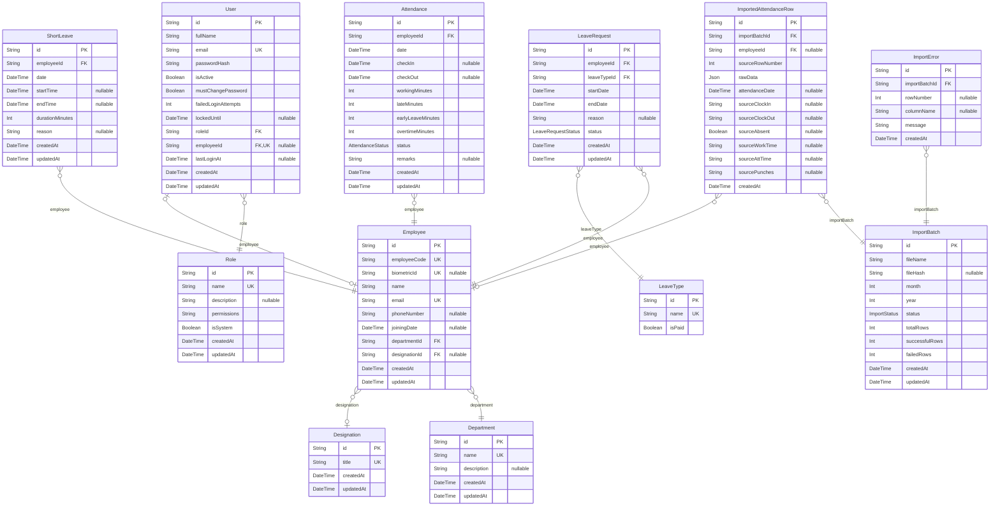

# My Database Schema

> Generated by [`prisma-markdown`](https://github.com/samchon/prisma-markdown)

- [default](#default)

## default

### `Department`

Properties as follows:

- `id`:
- `name`:
- `description`:
- `createdAt`:
- `updatedAt`:

### `Designation`

Properties as follows:

- `id`:
- `title`:
- `createdAt`:
- `updatedAt`:

### `Employee`

Properties as follows:

- `id`:
- `employeeCode`:
- `biometricId`:
- `name`:
- `email`:
- `phoneNumber`:
- `joiningDate`:
- `departmentId`:
- `designationId`:
- `createdAt`:
- `updatedAt`:

### `Attendance`

Properties as follows:

- `id`:
- `employeeId`:
- `date`:
- `checkIn`:
- `checkOut`:
- `workingMinutes`:
- `lateMinutes`:
- `earlyLeaveMinutes`:
- `overtimeMinutes`:
- `status`:
- `remarks`:
- `createdAt`:
- `updatedAt`:

### `ImportBatch`

Properties as follows:

- `id`:
- `fileName`:
- `fileHash`:
- `month`:
- `year`:
- `status`:
- `totalRows`:
- `successfulRows`:
- `failedRows`:
- `createdAt`:
- `updatedAt`:

### `ImportedAttendanceRow`

Properties as follows:

- `id`:
- `importBatchId`:
- `employeeId`:
- `sourceRowNumber`:
- `rawData`:
- `attendanceDate`:
- `sourceClockIn`:
- `sourceClockOut`:
- `sourceAbsent`:
- `sourceWorkTime`:
- `sourceAttTime`:
- `sourcePunches`:
- `createdAt`:

### `ImportError`

Properties as follows:

- `id`:
- `importBatchId`:
- `rowNumber`:
- `columnName`:
- `message`:
- `createdAt`:

### `LeaveType`

Properties as follows:

- `id`:
- `name`:
- `isPaid`:

### `LeaveRequest`

Properties as follows:

- `id`:
- `employeeId`:
- `leaveTypeId`:
- `startDate`:
- `endDate`:
- `reason`:
- `status`:
- `createdAt`:
- `updatedAt`:

### `ShortLeave`

Properties as follows:

- `id`:
- `employeeId`:
- `date`:
- `startTime`:
- `endTime`:
- `durationMinutes`:
- `reason`:
- `createdAt`:
- `updatedAt`:

### `Role`

Properties as follows:

- `id`:
- `name`:
- `description`:
- `permissions`:
- `isSystem`:
- `createdAt`:
- `updatedAt`:

### `User`

Properties as follows:

- `id`:
- `fullName`:
- `email`:
- `passwordHash`:
- `isActive`:
- `mustChangePassword`:
- `failedLoginAttempts`:
- `lockedUntil`:
- `roleId`:
- `employeeId`:
- `lastLoginAt`:
- `createdAt`:
- `updatedAt`:
